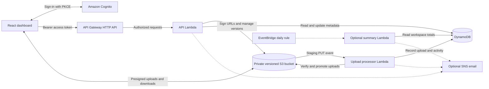
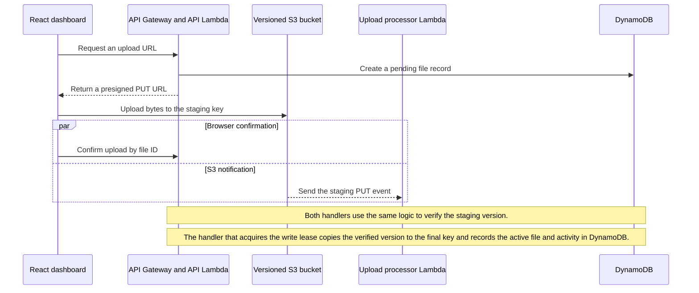
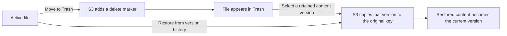

# CloudVault

Intelligent Serverless Cloud Storage & Recovery System for a two-person university Cloud Technology PBL.

Phase 2A adds an authenticated AWS integration alongside the Phase 1 browser demo. The local checks use synthetic credentials and mocked AWS SDK calls. AWS resource creation and live acceptance are manual steps. [AWS Console setup](infrastructure/console-guides/manual-setup.md).

## Tech stack

| Layer | Technologies | Role |
| --- | --- | --- |
| Frontend | React, TypeScript, Vite, Tailwind CSS | Dashboard, file management, version history, and analytics |
| Browser demo | IndexedDB | Stores sample and uploaded files in the browser. Runs without an AWS account or Python server. |
| Authentication and API | Amazon Cognito, OAuth 2.0 with PKCE, Amazon API Gateway HTTP API | Signs in the workspace owner and validates JWTs on protected routes |
| Backend | Python 3.12, AWS Lambda, Boto3 | Handles API requests and verifies and promotes uploads |
| Storage | Amazon S3 with versioning, Amazon DynamoDB | S3 stores file content and retained versions. DynamoDB tracks metadata, activity, and share expiration. |
| Permissions and logging | AWS IAM, Amazon CloudWatch Logs | Limits Lambda permissions and captures function logs |
| Optional email | Amazon EventBridge, Amazon SNS | Schedules the daily summary and sends email notifications |
| Testing and formatting | pytest, Botocore Stubber, Vitest, Prettier | Runs local tests and checks frontend formatting |

## Architecture diagrams

### AWS architecture



### File upload



### File deletion and recovery



See [the architecture notes](docs/architecture.md) for the DynamoDB data model, upload retries, and recovery behavior.

## Run the browser demo

Use Node.js 22+ and npm. Python 3.12 is required for backend work. From the repository root:

```sh
cd frontend
npm ci
VITE_CLOUDVAULT_MODE=demo npm run dev
```

Open the URL printed by Vite, normally `http://127.0.0.1:5173/`. All six pages work in explicitly labeled demo mode. Data and file blobs stay in this browser's IndexedDB. Sample downloads are labeled and their stored sizes feed the demo analytics. Files are capped at 5 MiB. Settings can reset or clear the local workspace. [Local demonstration walkthrough](docs/demo-walkthrough.md) · [Phase 1 desktop preview](docs/screenshots/desktop.jpg) · [Phase 1 mobile preview](docs/screenshots/mobile.jpg).

## Run checks

From the repository root:

```sh
python3.12 -m venv .venv
.venv/bin/python -m pip install -r backend/requirements-dev.txt
.venv/bin/python -m pytest backend/tests -q
cd frontend
npm ci
npm test
npm run typecheck
npm run build
npm run format:check
```

## Optional Python loopback simulator

Use the same virtual environment. This independent in-memory server simulates file metadata and confirmation, and returns 501 for download and share. It binds to `127.0.0.1:8000`. The demo UI does its own local storage.

```sh
export CLOUDVAULT_MODE=local
export CLOUDVAULT_AUTH_MODE=local-token
export CLOUDVAULT_LOCAL_TOKEN="$(.venv/bin/python -c 'import secrets; print(secrets.token_urlsafe(32))')"
export CLOUDVAULT_ALLOWED_ORIGINS=http://127.0.0.1:5173,http://localhost:5173
.venv/bin/python -m backend.api.local
```

Protected simulator requests require that local bearer token. Health is at `http://127.0.0.1:8000/health`. Python reads process environment values. The env templates document the required settings.

## Run cloud mode after manual setup

Set `VITE_CLOUDVAULT_MODE=aws` in `frontend/.env.local` and fill the public API Gateway and Cognito settings from the Console guide. If the file already exists, edit it in place. From the repository root, run:

```sh
cd frontend
npm run dev -- --strictPort
```

Open `http://localhost:5173/` and sign in as the configured owner. The recommended callback and sign-out URL is `http://localhost:5173/` and uses that exact origin in both CORS configurations. Browser access tokens stay in memory and expire. The SPA reauthenticates after reload or expiration. Restart Vite after editing the environment. To use browser demo mode with the same file, run `VITE_CLOUDVAULT_MODE=demo npm run dev`.

## Repository map

| Path | Contents |
| --- | --- |
| `frontend/` | React dashboard, IndexedDB demo, cloud API client and Cognito PKCE flow |
| `backend/api/` | Lambda HTTP API and separate loopback server |
| `backend/shared/` | Validation, boto3 adapters, conditional DynamoDB operations and recovery |
| `backend/processors/` | Staging PUT event processor |
| `backend/scheduled/` | Optional daily summary |
| `backend/tests/` | Network-free tests with synthetic credentials and SDK stubs |
| `infrastructure/` | Manual Console guide, package instructions and scoped IAM templates |
| `docs/` | API contract, data model, consistency and verification notes |

[API contract](docs/api-contract.md) · [Architecture](docs/architecture.md) · [Verification](docs/verification.md) · [IAM policies](infrastructure/iam-policies/README.md) · [Setup and cleanup](infrastructure/console-guides/manual-setup.md).
