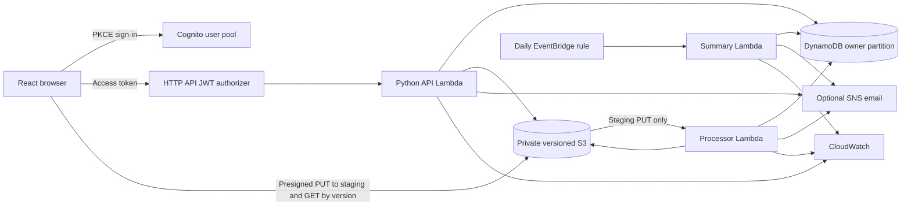

# CloudVault architecture

The browser demo uses IndexedDB. A separate Python loopback simulator uses process memory and local bearer auth. Cloud mode requires sign-in and gets its data only from the configured API. AWS clients initialize lazily inside cloud handlers.

## DynamoDB keys and indexes

Table `cloudvault-metadata` uses string `PK` and `SK`, on-demand billing, and TTL attribute `expiresAtEpoch`. No GSIs or LSIs are required. All items use `PK = OWNER#<configured-sub>`.

| SK | Purpose and retention |
| --- | --- |
| `FILE#<file-uuid>` | Public file metadata, revision, processing state, current version, upload receipt and optional in-flight operation. Kept for recovery. |
| `FOLDER#<folder-uuid>` and `FOLDERNAME#<sha256-of-casefolded-name>` | Folder metadata and transactional unique name guard. |
| `ACTIVITY#<utc-timestamp>#<uuid>` | File state changes and share creation, with 30-day TTL. |
| `SHARE#<utc-timestamp>#<uuid>` | File/version and expiration metadata, with seven-day TTL. No raw URLs. |
| `OP#<file-uuid>#<retry-key>` | Completed delete/restore replay receipts, with seven-day TTL. |
| `NOTICE#<operation-or-utc-day>` | Notification attempt claim, with 14-day TTL. |
| `QUOTA#FILES`, `QUOTA#FOLDERS` | Workspace counts capped at 200 intents and 40 folders. File quota includes pending and trash. |
| `QUOTA#SHARE#<utc-epoch-day>`, `QUOTA#NOTICE#<utc-epoch-day>` | Counters capped at 30 share creations and five upload/recovery notice attempts per day. Two-day TTL. |

Normal reads use GetItem or paginated Query with the owner partition and sort key prefix. Search and arbitrary sort use a bounded list of at most 200 file records instead of a table scan or a separate index for each sort. DynamoDB Query resumes using the last evaluated sort key. The SPA fetches the bounded file list, up to 100 activity and share entries, and loads individual S3 version pages on demand. The activity chart describes the loaded events. TTL cleanup is eventual. Share authorization compares actual expiration.

## Upload, recovery, and failure handling

1. The API verifies the caller and stores a conditional pending file intent and quota update. The five-minute presigned PUT targets `uploads/<owner>/<file>/content`, signs the exact size, declared MIME, SSE-S3 and expected bucket owner, and uses `If-None-Match: *`. The browser sends file bytes straight to S3.
2. Both confirmation and `ObjectCreated:Put` use one path. It accepts only the latest exact staging version for a pending file and verifies version, MIME, length and encryption with HEAD. The event handler checks source, type, bucket, generated key shape, version and sequencer. Older events cannot update the same file after acceptance. A duplicate event can still attempt the notification claim without writing duplicate activity.
3. A conditional revision write acquires the file operation for 60 seconds. CopyObject promotes the verified staging version to `owners/<owner>/files/<file>/content`. Canonical writes never match the staging event filter. The file state and one activity record are committed in the same DynamoDB transaction. Staging copies are temporary and expire under a prefix-only lifecycle rule.
4. Deletion creates a marker on the canonical key. Restore copies an exact retained content version to the same key, including when a marker is current. Neither operation permanently deletes content versions. Version IDs are carried unchanged. The current object's version and size are checked before issuing fresh download/share capabilities.
5. When a writer fails after S3 succeeds, the next invocation of the same operation after the lease checks the current marker or the copy's operation ID before applying any new S3 mutation. Keep writer Lambda timeouts shorter than the lease. This bounds overlapping writers and supports retries, without promising a distributed transaction. An ambiguous S3 request that completes unusually late or writes made outside CloudVault can still require inspection. Failed operations can be retried from Pending, Trash or version history as applicable.
6. Upload/recovery email and summary email are independently optional. A transaction claims the event/day before one SNS publish attempt. This favors avoiding application-generated repeats when delivery is ambiguous. A crash after the claim can lose a notice, and SNS Standard delivery can duplicate email. Notifications carry no file content, names or presigned URLs.

Analytics sums active bytes and versions recorded by CloudVault. Staging objects, externally changed objects, and billed storage overhead are outside those totals. Canonical S3 versioning supports recovery but shares the account and bucket failure boundary. Keep a separate backup if required.

The workspace bounds suit a single-owner demonstration. The API has no permanent purge, nested folders, malware scanner or automatic general-purpose reconciler. AWS integration and IAM are validated locally with mocks. Complete the live acceptance tests after manual setup. [Manual Console setup](../infrastructure/console-guides/manual-setup.md).
